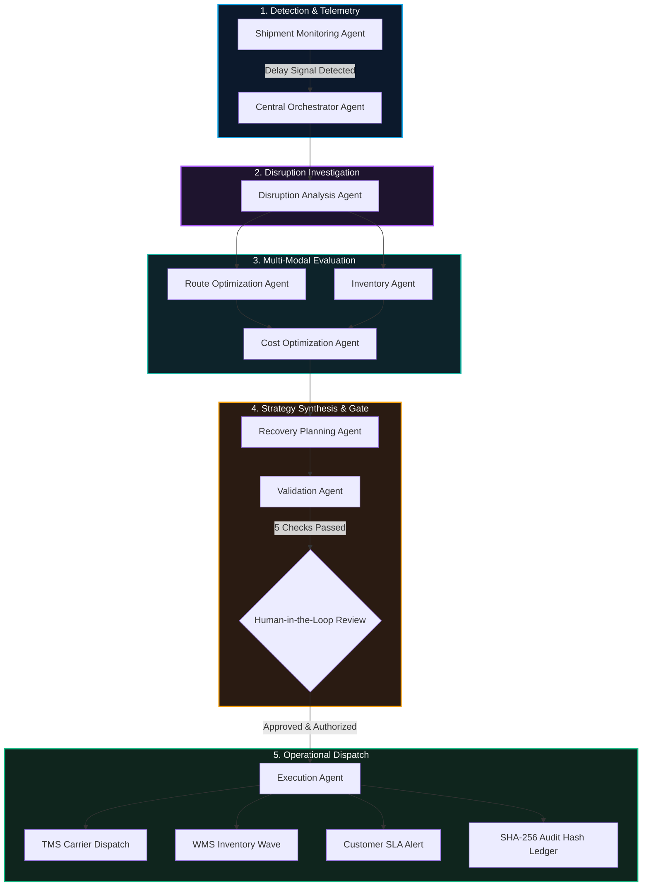

<div align="center">

# ⚡ AgentForge Logistics
### **Intelligent Logistics. Autonomous Coordination. Reliable Disruption Recovery.**

[](https://python.org)
[](https://fastapi.tiangolo.com)
[](https://react.dev)
[](https://typescriptlang.org)
[](https://tailwindcss.com)
[](https://deepmind.google/technologies/gemini/)
[](LICENSE)

<br/>

**AgentForge Logistics** is a production-grade Agentic AI supply chain control tower and disruption recovery platform. Coordinated by **9 specialized AI agents**, the system continuously monitors freight telemetry, proactively detects route bottlenecks, checks regional warehouse inventory buffers, calculates deterministic detour and toll costs, and synthesizes prioritized recovery strategies under strict **Human-in-the-Loop** governance.

[Key Features](#-key-features) • [Multi-Agent Architecture](#-multi-agent-system-architecture) • [Dashboard Views](#-the-6-control-tower-views) • [Quickstart](#-quickstart-guide) • [API Reference](#-api-endpoints)

</div>

---

## 🌟 Key Features

<table>
  <tr>
    <td width="50%">
      <h3>🛰️ Autonomous Proactive Monitoring</h3>
      <p>Continuous GPS telemetry tracking, speed profiling, and automatic delay risk detection before SLA deadlines are breached.</p>
    </td>
    <td width="50%">
      <h3>🤖 9 Specialized AI Agents</h3>
      <p>Decentralized multi-agent system coordinating root cause analysis, route detours, regional warehouse stock, and recovery synthesis.</p>
    </td>
  </tr>
  <tr>
    <td width="50%">
      <h3>⚖️ Zero Financial Hallucination</h3>
      <p>LLMs coordinate strategy and explain decisions; deterministic engines calculate FASTag tolls, fuel consumption, and contractual SLA penalties.</p>
    </td>
    <td width="50%">
      <h3>🛡️ Human-in-the-Loop Governance (FR-08)</h3>
      <p>Consequential operational actions (carrier reassignment, inventory transfer) strictly require human authorization before execution.</p>
    </td>
  </tr>
  <tr>
    <td width="50%">
      <h3>📊 4-Way Recovery Strategy Matrix</h3>
      <p>Compares Continuing Route vs SH-116 Bypass vs Alternate Carrier Reassignment vs Emergency Fulfillment with concrete ROI.</p>
    </td>
    <td width="50%">
      <h3>🔐 Immutable Cryptographic Audit Ledger</h3>
      <p>Every operational dispatch generates a verifiable SHA-256 confirmation hash and idempotency key recorded to an audit trail.</p>
    </td>
  </tr>
</table>

---

## 🏗️ Multi-Agent System Architecture



### The 9 Specialized Agents in Detail

| # | Agent | Persona & Primary Responsibility | Tools & Data Interfaces | Key Output |
| :---: | :--- | :--- | :--- | :--- |
| **1** | **Central Orchestrator** | Coordinates agent lifecycle, task state machine, and dependency graph | `dispatch_agent_pipeline`, `state_store` | Execution pipeline status & final operational decision |
| **2** | **Shipment Monitoring** | Continuously evaluates GPS coordinates, speeds, and ETA deviation | `gps_telemetry_fetch`, `calculate_eta_delta` | Real-time status (`in_transit`, `at_risk`, `delayed`) |
| **3** | **Disruption Analysis** | Investigates root causes, traffic radar feeds, and order downtime impact | `query_traffic_radar_api`, `query_order_impact` | Root cause classification & affected order list |
| **4** | **Inventory Agent** | Queries multi-hub stock availability, reserved allocations, and safety buffers | `query_wms_stock_levels`, `check_reservation_feasibility` | Candidate fulfillment hubs (Hosur, Vellore, Chennai) |
| **5** | **Route Optimization** | Models physical road detours, highway restrictions, and travel duration | `routing_engine_compute`, `calculate_tolls_and_fuel` | Detour corridors (SH-116 bypass, express lanes) |
| **6** | **Cost Optimization** | Deterministic trade-off calculations: tolls, fuel, expedite fees vs SLA fines | `calculate_fuel_burn_cost`, `fetch_fastag_toll_rates` | Net financial impact & penalty savings (₹) |
| **7** | **Recovery Planning** | Synthesizes findings into 4 ranked recovery strategies with feasibility scores | `rank_recovery_matrix`, `generate_contingency_steps` | 4-way strategy comparison proposal |
| **8** | **Validation Agent** | Enforces 5 physical and policy gate checks before execution | `verify_route_clearance`, `audit_cost_mathematics` | Validation status (`PASS` / `HELD_FOR_APPROVAL`) |
| **9** | **Execution Agent** | Dispatches authorized actions to TMS/WMS with cryptographic audit ledger | `tms_dispatch_reassignment`, `write_immutable_audit_ledger` | SHA-256 confirmation hash & idempotency token |

---

## 🖥️ The 6 Control Tower Views

### 1. 🎛️ Logistics Control Tower
Executive command center displaying active fleet status, delay counts, SLA adherence percentage, total line stoppage penalties avoided, and a real-time disruption banner with instant navigation to resolution workflows.

### 2. 🗺️ Shipment Tracking & Corridor Map
Interactive dark-mode Leaflet map tracking vehicles along the Chennai–Bengaluru corridor with waypoint checkpoints, speed telemetry, delay indicators, and vehicle specification drawers.

### 3. 🧠 Multi-Agent Workflow Execution Graph
Visual node graph illustrating all 9 agents in real time, complete with latency badges, tool execution logs, prompt reasoning summaries, and architectural rule compliance indicators.

### 4. 🛡️ Human-in-the-Loop Recovery Center
Direct incident review comparing 4 operational recovery options:
- **Option 1**: *Alternate Carrier Reassignment* (+₹2,400 | ETA 5:45 PM | **On-Time SLA** | **AI Recommended**)
- **Option 2**: *Alternative Route via SH-116 Bypass* (+₹850 | ETA 6:30 PM | Late by 30m)
- **Option 3**: *Emergency Fulfillment from Hosur Hub* (+₹3,200 | ETA 5:30 PM | On-Time SLA)
- **Option 4**: *Continue on Current Route* (₹0 | ETA 8:00 PM | ₹75,000 SLA Penalty Exposure)
Includes an operational approval form with reviewer signatures, confetti confirmation, and ledger block commitment.

### 5. 📦 Warehouses & Stock Network
Regional hub breakdown (Chennai Central, Vellore Distribution Node, Hosur Fulfillment Center, Bengaluru East Hub) with pallet capacity meters, SKU reserve balances, and safety threshold alerts.

### 6. 📈 System Observability & Immutable Audit Trail
Target vs actual PRD KPI tracking (98.2% detection recall, 340ms latency, 0 unauthorized actions) and an immutable tabular audit trail recording every actor, entity, SHA-256 confirmation hash, and idempotency key.

---

## 🚀 Quickstart Guide

### 📋 Prerequisites
- **Python**: 3.10+ (Tested on Python 3.13)
- **Node.js**: v18+ (Tested on Node.js v22)
- **Git**

### 1. Clone & Setup Repository
```bash
git clone https://github.com/Harshith-ka/Logistics-Multi-Agent.git
cd Logistics-Multi-Agent
```

### 2. Backend Setup
```bash
# Create and activate virtual environment
python -m venv venv

# Windows (PowerShell)
.\venv\Scripts\Activate.ps1

# Linux / macOS
source venv/bin/activate

# Install dependencies
pip install fastapi "uvicorn[standard]" pydantic python-dotenv httpx google-genai websockets pytest

# Run automated integration test suite
pytest backend/test_system.py -v

# Start FastAPI backend server
cd backend
python -m uvicorn main:app --host 127.0.0.1 --port 8000 --reload
```

### 3. Frontend Setup
```bash
# In a new terminal window:
cd frontend

# Install frontend dependencies
npm install

# Start Vite dev server
npx vite --host 127.0.0.1 --port 5173
```

Open **`http://127.0.0.1:5173`** in your browser.

---

## 🧪 Interactive Live Demo Scenarios

1. **Trigger NH48 Highway Collision**:
   - In the top navigation bar, click the red **`Demo NH48 Collision`** button.
   - Vehicle `SHP-1024` on the Chennai–Bengaluru corridor immediately enters an `at_risk` state (+95m delay).
   - The Central Orchestrator activates the specialized agents in sequence.
   - The UI automatically navigates to the **Recovery Center** displaying the 4-way strategy comparison matrix.
2. **Authorize Recovery Plan**:
   - Inspect the AI-recommended strategy (*Alternate Carrier Reassignment to Delhivery Rapid Freight* at ₹2,400 avoiding ₹75,000 penalties).
   - Click **`Approve & Execute via TMS/WMS`**.
   - Confetti triggers, a SHA-256 confirmation hash is committed, and vehicle `SHP-1024` status updates to `recovering`.
3. **Custom Disruption Injection**:
   - Click **`Inject Disruption`** to trigger custom vehicle breakdowns, flash expressway flooding, or warehouse gate congestion on any active shipment.

---

## 🔌 API Endpoints

| Method | Endpoint | Description |
| :---: | :--- | :--- |
| `GET` | `/api/health` | Backend status and LLM mode verification |
| `GET` | `/api/shipments` | List active fleet shipments with GPS telemetry |
| `GET` | `/api/shipments/{id}` | Detailed shipment waypoint and cargo profile |
| `GET` | `/api/incidents` | Active logistics incidents and severity levels |
| `POST` | `/api/incidents/inject` | Trigger simulated disruption fault injection |
| `GET` | `/api/recovery/plans` | Fetch generated multi-agent recovery proposals |
| `POST` | `/api/recovery/approve` | Human-in-the-Loop operational approval and execution |
| `GET` | `/api/inventory/warehouses` | Regional warehouse capacities and locations |
| `GET` | `/api/inventory/items` | SKU stock reserves (available vs reserved) |
| `GET` | `/api/agents/runs` | Agent execution runs, tool calls, and latency |
| `GET` | `/api/agents/workflow/{id}` | Visual node & edge graph topology for active incident |
| `GET` | `/api/analytics/kpis` | Real-time control tower performance indicators |
| `GET` | `/api/analytics/audit` | Immutable cryptographic audit ledger |
| `WS` | `/ws/telemetry` | WebSocket stream for live fleet GPS updates |

---

## 📂 Repository Layout

```
Logistics-Multi-Agent/
├── backend/
│   ├── agents/
│   │   ├── base.py            # Base agent with Gemini LLM & deterministic engine
│   │   ├── orchestrator.py    # Central coordinator & pipeline state machine
│   │   ├── monitoring.py      # Telemetry & ETA deviation detector
│   │   ├── disruption.py      # Root cause & order impact analyzer
│   │   ├── inventory.py       # Warehouse reserves & buffer checker
│   │   ├── route.py           # Deterministic routing & detour modeling
│   │   ├── cost.py            # Deterministic financial trade-offs & ROI
│   │   ├── recovery.py        # Ranked strategy synthesis
│   │   ├── validation.py      # Constraint checking gatekeeper
│   │   └── execution.py       # TMS/WMS dispatch & cryptographic hashing
│   ├── routes/                # FastAPI endpoint routers
│   ├── config.py              # Configuration & settings
│   ├── database.py            # Reactive repository & corridor topology
│   ├── models.py              # Pydantic schemas
│   ├── simulator.py           # Real-time ticking engine & fault injection
│   ├── main.py                # FastAPI app & WebSocket telemetry
│   └── test_system.py         # End-to-end integration test
├── frontend/
│   ├── src/
│   │   ├── components/
│   │   │   ├── Header.tsx                 # Navigation & simulation controls
│   │   │   ├── ControlTowerView.tsx       # Executive KPIs & active incidents
│   │   │   ├── ShipmentTrackingView.tsx   # Interactive Leaflet map & fleet
│   │   │   ├── MultiAgentWorkflowView.tsx # 9-Agent visual graph & reasoning
│   │   │   ├── RecoveryCenterView.tsx     # Comparison cards & approval modal
│   │   │   ├── InventoryView.tsx          # Regional hubs & SKU reserves
│   │   │   ├── AnalyticsView.tsx          # SLA benchmarks & audit ledger
│   │   │   └── DisruptionModal.tsx        # Manual fault injection modal
│   │   ├── api.ts                         # REST & simulation client
│   │   ├── types.ts                       # TypeScript interfaces
│   │   ├── App.tsx                        # Main application container
│   │   └── index.css                      # Glassmorphic dark styling
│   └── package.json
├── .gitignore                 # Python, Node, Vite exclusion rules
└── README.md                  # System documentation & setup guide
```

---

## 📜 License & Compliance

This project is licensed under the **MIT License**. Built in compliance with autonomous logistics governance principles requiring **Human-in-the-Loop** verification for consequential operational dispatch actions.
